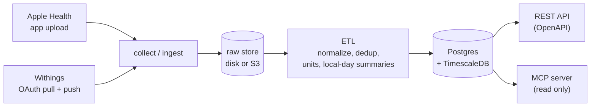

<p align="center">
  <picture>
    <source media="(prefers-color-scheme: dark)" srcset="docs/assets/wordmark-dark.svg">
    <source media="(prefers-color-scheme: light)" srcset="docs/assets/wordmark.svg">
    
  </picture>
</p>

<p align="center">
  <strong>Collect health data from devices and apps, keep every raw payload, serve it back as one clean model.</strong><br>
  Self-hostable, free, AGPL-3.0. One Go binary plus Postgres.
</p>

<p align="center">
  <a href="https://github.com/soma-intelligence/open-health-sync/actions/workflows/ci.yml"></a>
  <a href="https://github.com/soma-intelligence/open-health-sync/releases"></a>
  <a href="LICENSE"></a>
  <a href="go.mod"></a>
</p>

<p align="center"><b>Status:</b> v0.0.1 early preview. APIs, configuration and schema may change in any 0.x release.</p>

---

Open Health Sync (`ohs`) is a self-hosted ingestion and normalization layer for health data.
It pulls from providers, accepts uploads from phones, stores each payload verbatim, maps it to
one canonical model with one set of units, and serves it over a REST API and a read-only MCP
server. It is not a dashboard, a coaching app or a hosted service, and it is not a medical
device or clinical software.

## Why

- **Open standards first.** Units and quantity names come with UCUM units and LOINC codes, the
  API is described by an OpenAPI file, and agents read through the open Model Context Protocol.
- **One binary plus Postgres.** The queue lives in Postgres (`FOR UPDATE SKIP LOCKED`). There
  is no message broker, cache or separate worker fleet to run.
- **Raw payloads are kept.** Every upload and pull lands in a raw store (local folder or S3)
  before anything else and is never rewritten. After a mapper fix, any user can be
  re-processed from the raw files ([how](docs/self-hosting.md#operating-notes)).
- **Real erasure.** `DELETE /v1/users/{id}` removes the user's raw files and every row, then the
  user. Not a soft flag. `GET /v1/deletions/{job_id}` tells you when it is done.
- **Runs small.** A Raspberry Pi 5 with 4 GB runs the full stack, with a compose overlay tuned
  for it.
- **Read-only MCP for AI agents.** A person can point their own agent at their own data, with a
  token that can only read.
- **No scores, no AI inside.** It stops at clean, traceable data. Build insights on top.

## Architecture



The `api`, `collect` and `etl` roles run in one process or split across several. Details in
[docs/architecture.md](docs/architecture.md).

## Quickstart

You need Docker with Compose v2.24 or later, plus `curl`, `jq` and `openssl`. Compose pulls the
published image `ghcr.io/soma-intelligence/open-health-sync` (amd64 and arm64).

```sh
git clone https://github.com/soma-intelligence/open-health-sync.git && cd open-health-sync
cp .env.example .env
sed -i.bak "s|^OHS_ENCRYPTION_KEY=.*|OHS_ENCRYPTION_KEY=$(openssl rand -base64 32)|" .env
docker compose --env-file .env -f deploy/docker-compose.yml up -d --wait
docker compose --env-file .env -f deploy/docker-compose.yml exec ohs /ohs admin tenant create --name dev
```

The last command prints a tenant API key once. Keep it:

```sh
export OHS=http://localhost:8080
export KEY=ohs_sk_...    # the key printed above
```

Port 8080 taken? Set `OHS_HTTP_PORT` and a matching `OHS_PUBLIC_URL` in `.env` (see
[self-hosting](docs/self-hosting.md#port-and-a-second-install)).

Create an end user and a token the user's app would hold:

```sh
USER_ID=$(curl -s -X POST $OHS/v1/users -H "Authorization: Bearer $KEY" \
  -H 'Content-Type: application/json' -d '{"external_ref":"demo"}' | jq -r .id)
TOKEN=$(curl -s -X POST $OHS/v1/users/$USER_ID/tokens -H "Authorization: Bearer $KEY" \
  -H 'Content-Type: application/json' -d '{"scopes":["upload"]}' | jq -r .token)
```

Upload one Apple Health part (one heart rate reading, gzip compressed):

```sh
DAY=$(date -u +%Y-%m-%d); NOW=$(date -u +%Y-%m-%dT%H:%M:%SZ)
printf '{"quantityType":"HKQuantityTypeIdentifierHeartRate","startDate":"%s","endDate":"%s","value":72,"unit":"count/min","sourceName":"Demo Watch","metadata":{"HKTimeZone":"UTC"}}\n' "$NOW" "$NOW" \
  | gzip | curl -s -X POST $OHS/v1/ingest/apple-health \
    -H "Authorization: Bearer $TOKEN" -H "Content-Type: application/gzip" \
    -H "X-OHS-Type: HKQuantityTypeIdentifierHeartRate" -H "X-OHS-Day: $DAY" \
    -H "X-OHS-Batch: demo1" -H "X-OHS-Part: 0" --data-binary @-
```

Wait until processing is done (`pending_jobs` is 0), then read the normalized sample back:

```sh
curl -s "$OHS/v1/users/$USER_ID/coverage" -H "Authorization: Bearer $KEY"
curl -s "$OHS/v1/users/$USER_ID/samples?type=heart_rate" -H "Authorization: Bearer $KEY"
```

`ohs doctor` checks the configuration at any time:
`docker compose --env-file .env -f deploy/docker-compose.yml run --rm ohs doctor`.
Data lives in the `pgdata` and `raw` volumes; `docker compose ... down` keeps them.

## What you get

| Area | Item | Status |
|---|---|---|
| Sources | Apple Health (your app uploads HealthKit data, [contract](docs/connectors/apple-health.md)) | Available |
| Sources | Withings (OAuth, scheduled pulls, push notifications, [guide](docs/connectors/withings.md)) | Available (not yet verified with a real account) |
| Sources | Oura, Whoop, Ultrahuman, Garmin, Fitbit, Polar, Strava, Coros, Suunto | Planned |
| Sources | Dexcom, Libre, Omron; Health Connect through the Android SDK | Planned |
| Outputs | REST JSON, described by [api/openapi.yaml](api/openapi.yaml) | Available |
| Outputs | MCP server, read only ([docs/mcp.md](docs/mcp.md)) | Available |
| Outputs | Read routes for ECG recordings and heartbeat (RR) series, which are stored today | Planned |
| Outputs | Outgoing webhooks, FHIR R4, Open mHealth, CSV and Parquet exports | Planned |
| SDKs | Swift, Kotlin, React Native, Flutter | Planned |

Planned means on the roadmap and not in this release.

## Connect an AI agent to your data

Mint a user token with only the `read` scope (it may live up to 30 days):

```sh
curl -s -X POST $OHS/v1/users/$USER_ID/tokens -H "Authorization: Bearer $KEY" \
  -H 'Content-Type: application/json' -d '{"scopes":["read"],"ttl_seconds":2592000}'
```

Then add `ohs mcp` (stdio) to your desktop agent's `mcpServers`:

```json
{
  "mcpServers": {
    "open-health-sync": {
      "command": "/usr/local/bin/ohs",
      "args": ["mcp"],
      "env": { "OHS_MCP_URL": "http://localhost:8080", "OHS_MCP_KEY": "ohs_ut_..." }
    }
  }
}
```

`OHS_MCP_URL` must be `https` unless the host is loopback. Agents that speak Streamable HTTP
can call `/mcp` directly with the bearer token. Tools, arguments and paging:
[docs/mcp.md](docs/mcp.md).

## Data model

Every source maps into these records (see [docs/data-model.md](docs/data-model.md) for fields
and units):

- **QuantitySample**: one scalar measurement, such as heart rate, steps or SpO2.
- **CategorySample**: a categorical event, such as a stand hour or a menstrual flow entry.
- **SleepSession** and **SleepPhase**: a night with its duration breakdown, then each stage.
- **Workout** and **RoutePoint**: a session with its metrics, then its GPS track.
- **NutritionLog**: a food or drink entry with its nutrients.
- **ECGRecording** and **ECGVoltageSample**: the recording's metadata, then the voltage trace.
  Stored, not served yet: the read route is planned.
- **HeartbeatSample**: one beat-to-beat (RR) interval. Stored, not served yet: the read route is
  planned.
- **DailySummary**: totals per local day, from the provider or rolled up from samples.
- **Observation**: a generic coded fact for the long tail. No connector writes it yet.

Each record carries its provenance: `provider`, `source`, `device` and `ingested_at`.

## Deploy

- **Compose with the published image.** `deploy/docker-compose.yml`, as in the quickstart. Pin
  the tag with `OHS_VERSION` (there is no `latest` while 0.x). See
  [self-hosting](docs/self-hosting.md).
- **Raspberry Pi 5.** Add the overlay `deploy/docker-compose.pi.yml` (smaller Postgres buffers,
  memory limits). See [Raspberry Pi 5](docs/self-hosting.md#raspberry-pi-5-4-gb).
- **S3 raw store.** Add `deploy/docker-compose.s3.yml`, or point `OHS_RAW_STORE` at any S3
  compatible bucket. See [S3](docs/self-hosting.md#s3-compatible-raw-store).
- **Release binaries.** Linux and macOS, amd64 and arm64, with `checksums.txt`, on the
  [releases page](https://github.com/soma-intelligence/open-health-sync/releases). Bring your
  own Postgres with TimescaleDB and run `ohs up` (migrate, then serve). The macOS binaries are
  not signed yet: clear the quarantine flag with `xattr -d com.apple.quarantine ohs`.
- **Build from source.** Go 1.26: `make build` gives `bin/ohs`. For compose, add
  `deploy/docker-compose.build.yml`, which needs `docker buildx`; without it, see
  [build from source](docs/self-hosting.md#build-from-source).

## Documentation

- [Self-hosting](docs/self-hosting.md): configuration, images, Raspberry Pi, S3, operating notes.
- [API guide](docs/api.md) and the [OpenAPI file](api/openapi.yaml), the source of truth.
- [MCP server](docs/mcp.md): tools, credentials, desktop and remote agents.
- [Data model](docs/data-model.md): every canonical type and quantity name, with units.
- [Architecture](docs/architecture.md): roles, pipeline, storage, reliability.
- Connectors: [Apple Health](docs/connectors/apple-health.md),
  [Withings](docs/connectors/withings.md), [writing your own](docs/writing-a-connector.md).

## Status and roadmap

v0.0.1 is the first public release. What changed: [CHANGELOG.md](CHANGELOG.md). Install notes and
the full list of limitations: [release notes](docs/release-notes/v0.0.1.md).

Known limitations:

- After a hard kill, a job that was in flight is picked up again only after its 10 minute
  visibility timeout.
- One database and one raw store per instance; no multi-region replication.
- No FHIR, webhooks or mobile SDKs yet.
- The Withings portal steps and the units of physical effort and VO2 max are not verified on
  real devices yet.
- `/metrics` is unauthenticated: block it at your proxy or set `OHS_METRICS=false`.

Next: more connectors, standard outputs (FHIR R4, Open mHealth, exports, webhooks), then client
SDKs. Requests are welcome as GitHub issues, including the connector request form.

## Contributing

Read [CONTRIBUTING.md](CONTRIBUTING.md) and the [code of conduct](CODE_OF_CONDUCT.md). To add a
provider, start with [writing a connector](docs/writing-a-connector.md).

```sh
make setup        # git hooks
make build        # bin/ohs
make test         # unit tests
make integration  # needs Docker (testcontainers)
```

## Security

Report vulnerabilities privately, as described in [SECURITY.md](SECURITY.md). Never paste health
data, keys or tokens in a public issue.

## License

The server is AGPL-3.0-only, see [LICENSE](LICENSE). If you run a modified Open Health Sync as a
service, you publish your changes. The client SDKs will be MIT licensed when they exist.
